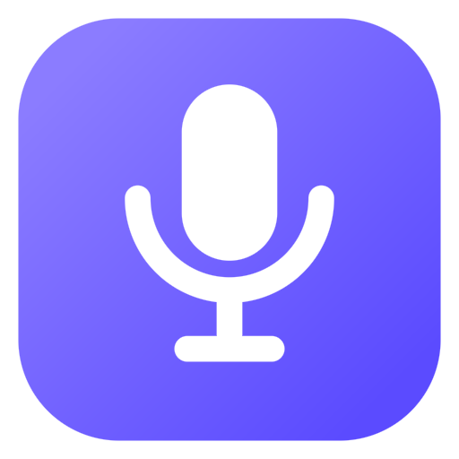

<p align="center">
  
</p>

<h1 align="center">MicMe</h1>

<p align="center">
  Use your phone as a <b>microphone</b>, <b>camera</b> and <b>screen</b> for your computer, and send <b>files both ways</b>.<br/>
  Works over a <b>phone hotspot</b>, <b>USB cable</b> or shared <b>Wi-Fi</b>. Pair in one scan with a <b>QR code</b>.
</p>

---

## What it does

| | Feature |
|---|---|
| 🎙️ | **Phone → PC microphone.** Raw 48 kHz audio streamed natively, the same way MicStream and WO Mic work, with optional noise suppression, echo cancellation and auto gain. On the PC: volume boost up to 300%, a level meter, and output to any device (pick a virtual cable to use it as a mic in Zoom, Discord, OBS and so on). |
| 📷 | **Phone → PC camera.** 360p / 720p / 1080p, front or back camera, switchable live from either device. |
| 📱 | **Phone screen sharing** (Android). Mirror the phone screen to the PC; it keeps streaming while you use other apps. |
| 📁 | **Two-way file transfer.** Send files from the phone to `Downloads/MicMe` on the PC, or drag and drop files onto the desktop app to send them to the phone. Both sides show progress. |
| 🔌 | **Real USB mode.** With USB debugging on, the PC links to the phone over the cable through `adb reverse` automatically, with no network needed for audio. |
| 🗂️ | **One tab per feature.** Connect, Audio, Camera, Screen and Files each get their own tab on the PC and on the phone. |
| 🔗 | **QR pairing.** The desktop shows a QR code with every address it can be reached on (USB, hotspot, Wi-Fi). The phone tries them all at once and keeps the first one that answers. A 6-character code allows manual entry. |
| 🔄 | **Rotation and gestures.** On the PC: scroll or pinch to zoom, drag to pan, double-click for fullscreen, `R` rotate, `M` mirror, `C` clean feed for OBS. On the phone: double-tap to flip camera, and a lock for auto-rotate, portrait or landscape. |
| 🎛️ | **Remote control.** Mute, toggle camera, flip, change quality and toggle voice cleanup on the phone from the desktop. |
| ⏺️ | **Recording.** Record the incoming audio and video to `Videos/MicMe` as WebM. |
| 📊 | **Live stats.** Latency, bitrate, resolution, fps, packet loss and jitter. |

## How it works

```
 ┌──────────── Phone (React Native / Expo) ────────────┐        ┌──────────── PC (Electron) ─────────────┐
 │ scan QR → micme://pair?h=IP1,IP2&p=8787&c=CODE      │        │ main process                             │
 │                                                     │  WS    │  • signaling relay  ws://0.0.0.0:8787/ws │
 │ MicMeSession ── hello{code} / offer / ice ─────────────────▶ │  • file API  POST /api/upload            │
 │              ◀─ welcome{token} / answer / control ──────────  │              GET  /api/files/:id         │
 │                                                     │        │  • network detection → QR code           │
 │ WebRTC  mic + camera/screen  ═══ peer-to-peer UDP ══════════▶ │ renderer (React)                         │
 │                                                     │        │  • RTCPeerConnection → video + WebAudio  │
 │ TransferManager  HTTP upload / download  ──────────────────▶ │  • output device, gain, meter, recorder  │
 └─────────────────────────────────────────────────────┘        └──────────────────────────────────────────┘
```

* **Audio** is captured by a small native Kotlin module (`mobile/modules/micme-audio`) using AudioRecord: 48 kHz mono PCM16 in 20 ms frames, sent as binary WebSocket messages to `/audio`. On the PC an AudioWorklet plays it through a ~60 ms jitter buffer that never grows past 200 ms. This path doesn't depend on WebRTC, so it works over hotspot, USB tethering, plain USB (`adb reverse`) and Wi-Fi.
* **Camera and screen** go straight from phone to PC over WebRTC on the local link. Nothing passes through the internet. Android's WebRTC normally ignores the phone's own hotspot and tethering interfaces; a config plugin turns that off (`WebRTC-AndroidNetworkMonitor-IsAdapterAvailable/Disabled/`), so video works on those links too.
* **Signaling** is a small WebSocket relay inside the desktop app. The phone must present the current pairing code, and wrong codes are rate-limited.
* **Files** use plain HTTP, the same approach as [LocalSend](https://github.com/localsend/localsend). Each pairing issues a random session token that every file request must carry.
* **USB** works two ways: plain USB with USB debugging (`adb reverse`, set up automatically when adb is installed), or *USB tethering*, which turns the cable into a network link.

## Requirements ("skills check")

Run this from the repo root to check everything at once:

```bash
npm run doctor
```

| Need | For | Required? |
|---|---|---|
| Node.js 20+ and npm | building both apps | ✅ |
| git | cloning, contributing | ✅ |
| Windows 10/11 (macOS/Linux build too) | running the desktop app | ✅ |
| Android 7+ phone (iPhone works except screen sharing) | running the phone app | ✅ |
| [VB-CABLE](https://vb-audio.com/Cable/) (free) | using the phone as a mic **inside other apps** | optional |
| [OBS Studio](https://obsproject.com) | using the phone as a webcam **inside other apps** | optional |
| Android Studio (JDK + SDK) **or** an Expo/EAS account | building the phone app | one of the two |

Skills used in the codebase: JavaScript/TypeScript, React 19, React Native 0.88 + Expo SDK 58, Electron 45, WebRTC, WebSockets, Node HTTP streams, Web Audio API, Expo config plugins.

## Quick start

```bash
git clone https://github.com/Heisdanito/micme.git
cd micme
npm run setup          # installs desktop + mobile dependencies
npm run doctor         # checks your tools
```

### Desktop app

```bash
npm run desktop        # dev mode with hot reload
npm run desktop:dist   # builds release/MicMe-Setup-x.y.z.exe and MicMe-Portable-x.y.z.exe
npm run collect        # copies the APK and both .exe files to ../builds/MicMe-x.y.z/
```

The installer adds a Windows Firewall rule so phones can connect over hotspot and USB networks, which Windows often marks as *Public*. If you use the portable build, allow MicMe when Windows asks.

### Phone app

MicMe uses native modules (WebRTC, screen capture), so it runs as its own app, not in Expo Go.

```bash
# Option A: local build (Android Studio installed)
cd mobile
npx expo prebuild -p android
cd android && ./gradlew assembleRelease      # → app/build/outputs/apk/release/app-release.apk

# Option B: cloud build (no Android Studio needed)
npm run mobile:apk                           # needs `npx eas-cli login` once
```

Install the APK, then for development run `npm run mobile` and open the dev build.

> **Windows tip:** if the Android build fails with *"Filename longer than 260 characters"*, the SDK's default CMake ships an old
> ninja that ignores Windows long paths. Install CMake 3.31+ from Android Studio's SDK Manager, then add it to
> `mobile/android/local.properties` (machine-local, not committed):
> ```properties
> cmake.dir=C:/Users/<you>/AppData/Local/Android/Sdk/cmake/3.31.6
> ```
> Adding `-PreactNativeArchitectures=arm64-v8a` to the Gradle command builds only for 64-bit phones, which is much faster.

## Connecting

1. Open **MicMe** on the PC. It shows a QR code and the links it can see.
2. Connect the two devices in one of these ways:
   * **Phone hotspot:** turn on the hotspot and join it from the PC.
   * **PC hotspot:** turn on Windows *Mobile Hotspot* and join it from the phone.
   * **USB (recommended for audio):** plug in the cable with USB debugging on. MicMe sets up the link by itself. Or turn on *USB tethering* (iPhone: *Personal Hotspot*).
   * **Wi-Fi:** put both on the same network.
3. In the phone app tap **Scan QR code**. You're live.

### Use the phone as a mic in Zoom / Discord / OBS
Install VB-CABLE, then in MicMe set **Send phone audio to → CABLE Input**. In the other app choose **CABLE Output** as the microphone. Turn on **Also play on my speakers** if you want to hear yourself.

### Use the phone as a webcam in other apps
Press **C** (clean feed) in MicMe, add a *Window Capture* of MicMe in OBS, then click **Start Virtual Camera**.

## Project layout

```
micme/
├─ desktop/                 Electron app
│  ├─ electron/             main process: signaling server, file API, network detection, IPC
│  ├─ src/                  React renderer: stage, audio engine, controls, files, stats
│  ├─ build/                icon + NSIS installer hook (firewall rule)
│  └─ test/                 node:test suites (pairing, server, transfers, SDP)
├─ mobile/                  Expo / React Native app
│  ├─ src/lib/              session (WebRTC), signaling, pairing, transfers, storage
│  ├─ src/screens/          Home, Scan, Stream
│  ├─ src/components/       UI kit, files sheet
│  └─ plugins/              config plugin that enables Android screen capture
├─ scripts/                 doctor (tool check) and icon generator
└─ private/                 your keys and keystores (git-ignored, never committed)
```

## Security notes

* MicMe only listens on your local networks. Media is encrypted end to end by WebRTC (DTLS-SRTP).
* Pairing needs the 6-character code from the QR. After 6 wrong tries an address is blocked for a minute. **New code** on the desktop rotates the code and drops the current phone.
* File endpoints need the per-session token, sanitize file names, and only write inside `Downloads/MicMe`.
* Signaling and file transfer use plain `ws://` and `http://` on the LAN, which is normal for local-only tools. Don't port-forward 8787 to the internet.
* Keep signing keys and `.env` files in `private/`. It is git-ignored.

## Known limitations

* Screen sharing and the native audio pipe are Android only. iOS would need its own audio module and a Broadcast Upload Extension.
* Plain-USB mode carries audio, files and control. Camera and screen video need a network link too (hotspot, tethering or Wi-Fi).
* Some Android versions pause the microphone while the app is in the background, unless you're screen sharing. Keep MicMe in front for mic-only use; the screen stays awake automatically.
* Guest and corporate Wi-Fi networks often block device-to-device traffic. Use a hotspot or USB instead.
* Using the phone as a mic or camera inside other apps relies on VB-CABLE or OBS, because MicMe does not install its own audio or camera drivers.

## License

[MIT](LICENSE)
